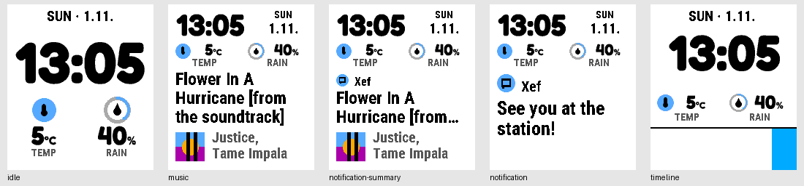

# Dynamic

A Pebble Time 2 watchface with chunky rounded time, two horizontal readings
and a layout that moves to make room for music, notifications and Timeline
Peek. Version 0.6.0 uses Fredoka clock outlines and Roboto Condensed text to
keep a consistent face as its layout changes. Dynamic is an independent
watchface by Xef.

It uses [Pebble Watchface Core](https://github.com/xefensor/pebble-watchface-core)
0.4.0, an updated version of the data engine used by
[Halftone](https://github.com/xefensor/halftone-watchface).

Install [Dynamic-0.6.0.pbw](dist/Dynamic-0.6.0.pbw); the
[source archive](dist/Dynamic-0.6.0-source.zip) is included. Dynamic has its own UUID,
`cc1281f1-3b4d-45b5-b235-6881b1fd8fbd`, so it can be installed alongside Halftone.
This is an early sideloaded build for the Pebble plugin preview. Public-store
submission remains on hold while Pebble's preview restriction applies.

## Layout



| State | Presentation |
| --- | --- |
| Normal | A shortened localized weekday and numeric date, large rounded clock and two equal reading columns |
| Music | A compact clock/header and both readings sit above a title that grows upward from a bottom-anchored artist/artwork footer |
| New notification | A brief source banner preserves the music footer; optional message previews use a bounded panel |
| Timeline Peek | The face follows Pebble's changing available area, retaining its clock and both readings above the native event panel |

New installs use a white page, black text and a Picton Blue accent. Saved page,
text and accent colors are retained when upgrading. The chosen accent colors
reading symbols, recognized rain-probability gauges and ordinary notification
symbols. Amber identifies low-battery/connection warnings. Secondary text and
artist text use quieter ink, falling back to foreground ink when muting would
lose contrast. Accent graphics also have a visibility fallback after Pebble's
palette rounding. The same composition works with a dark page. An optional
Quiet Time palette
uses separately chosen background, text and accent colours while the watch's
Quiet Time is active, then restores the daytime palette. Changes follow the watch at the next minute refresh. It follows the watch,
not a separate phone schedule.

The clock keeps the same Fredoka shapes while it scales and moves.
Temperature and percent units share that rounded style, with small muted
reading labels. Body text uses bundled Roboto Condensed. Both fonts come
with their SIL Open Font Licenses. The date stays plain, and the layout
shares one canvas without a dot border or text shadows. See
[the design notes](docs/NATIVE-STYLE.md) for the reference sources and decisions.

The first two global complication choices keep their left/right positions,
including when one is empty. Precise labels distinguish Temperature, Feels like,
High, Low, Forecast and Phone battery instead of presenting every temperature
as “Now” or every battery as an unspecified device. Neutral numbers, ranges and
times retain the source's labels. Long labels end in a measured ellipsis.

Selected public readings retain their identity through loading, unavailable,
denied, disabled and expired states without retaining a failed value. An
unconfigured slot stays empty. A clock mark means a known observation is at
least an hour old; cache origin or an unknown observation time alone does not
make that claim. Detailed receipt and observation ages remain separate in
settings. Timeline events remain native rather than being duplicated inside
the face.

The compact music/notification header stacks the weekday above the date.
Idle and Timeline Peek use a single-line date. Music titles can use up to
three lines, growing upward with a fixed gap above the footer. Artwork and
up to two artist lines share a fixed bottom edge, so their position stays
stable across short and long tracks.

Rain-probability percentages can use a 0–100% gauge when the source identifies
them as precipitation data. Other percentages keep their ordinary reading
presentation. Temperatures use a source image when supplied, or a thermometer.

One unified layout gives every installation the same readable hierarchy:

| Element | Idle | Music or message context | Timeline Peek |
| --- | --- | --- | --- |
| Rounded clock | 80px | 42px | 68px |
| Reading values | 36px | 22px | 26px |
| Reading symbols | 22px | 14px | 16px |

The idle date uses 20px text and reading labels use 14px. Idle reading values
and labels sit 4px and 6px closer to their symbols, respectively. Music titles stay at
24px and artist text at 20px for every track. Titles wrap through up to three
lines per page. A long received title continues through its remaining pages
once, then holds the final page; it never loops or selects a smaller font.
Artists use up to two lines, then an ellipsis. The 40px artwork tile and artist
text retain their bottom anchor at y216. Missing or transparent artwork uses a
simple fallback tile, keeping the artist in the same position while covers
arrive. A small pause mark appears during the five-second paused-music grace.
The 24px title size preserves three measured native lines above
the footer; 26px cannot reliably fit that space.

With notification previews disabled, a brief app/title banner reduces the
song-title area while preserving the footer. A heading-only notice can leave
two title lines at the same 24px size with a clear gap above the fixed footer.
Heading-only notices without music leave room for a larger clock and readings.
The former Larger text preference and preview size selector are retired;
existing saved choices also use this unified layout.

Short transitions explain changes of priority. A new song title can slide
inside the music area while the clock and readings stay still. Late covers,
artist metadata and notification icons update in place. There is no supplied
track identifier, so a changed primary title defines a new track for motion.
A notification burst enters once; updates within it remain in place. The face
settles after each transition. Turn **Animations** off to disable Dynamic's
own transitions; the layout still follows native Timeline Peek.

Notification sender/title and app identity remain separate. The sender is the
primary heading; the app icon normally supplies context. Without an app icon,
a quieter app-name line appears above the sender. Long app names do not shrink
the sender. App-only privacy shows the app name/icon and hides both sender and
message text. Message previews remain bounded, and privacy clearing takes
priority over completing an outgoing animation.

## Set up

[Settings preview: light](docs/images/settings-light.png) · [dark](docs/images/settings-dark.png)

1. Enable the Pebble app's plugin preview if your version requires it.
2. Configure slots 1–2 in the phone app's **Complications** settings. These are
   shared Pebble choices and can affect other faces using those slots. Dynamic
   retains their left/right positions and the selected provider's units.
3. Open Dynamic's **Appearance** group. Try the independent Idle, Music,
   Banner, Message and Timeline examples without changing any content or
   privacy preference. The 20 native samples cover five states, two clock
   formats and two themes. They are layout/colour examples, not live data.
4. Choose Light / Dark / Custom, accent and Follow Pebble / 12-hour / 24-hour.
   Returning to Custom restores that session's custom palette. Follow Pebble
   examples use the last OS format reported by the watch; an unknown format is
   explicitly labelled as an illustrative example. The read-only format query
   never changes the watchface's clock preference. Optionally choose a Quiet
   Time palette. A colour preset code such as `DYN1-FFFFFF-000000-55AAFF` shares
   only background, text and accent colours; importing it changes no content,
   privacy, app-filter or vibration preference.
5. In **Content**, check the shared reading summaries and adjacent recovery
   help, then choose music and notification visibility. A normal summary can
   include a sender or notification title; App-only hides the sender and body.
   Message previews are optional. Viewing a sample does not enable that feature;
   a nearby note identifies disabled examples.
6. For selected notification apps, add exact app names or Android package names
   as individual entries. Entries can be removed and replaced; matching ignores
   case. They are not an installed-app picker and do not verify that the named
   app exists on the phone. Optional notification vibration is Off, Short or
   Double. It uses the same app filter and respects the watch's Quiet Time.
7. The fixed Save area distinguishes unsaved edits from the last delivery.
   Save stores appearance settings on the phone and sends them to the watch.
   Undelivered settings retry automatically after reconnection. **Connection &
   help** shows the source snapshot and expandable technical details.
8. Allow the selected sources' permissions in Pebble. Music uses `ReadMusic`.

Music, animations and compact status indicators default to on. Notification
summaries, message previews and notification vibration default to off. Enable
them explicitly if wanted, and use the app-name filter to limit which
notifications appear.
Notification controls appear only when relevant. Startup and reconnect establish
a fresh baseline so accumulated notifications are not replayed. Native sample
previews are illustrative, not live data; custom recolouring is labelled approximate.
The settings page uses readable phone light/dark colours independently of the
watch palette, including its controls and selected values.

Dynamic follows the selected sources' formatted values and units. Weather
comes through Pebble's chosen plugin; this face has no separate HTTP weather
client, provider override or local temperature conversion.

## Dynamic content

A notification burst lasts at most three seconds for an app/summary banner,
or eight seconds when it contains a message preview. An earlier source expiry
can shorten it. The first notice sets the burst's deadline; ongoing updates,
including a body or icon arriving later, do not extend the interruption. Rapid
replacements are coalesced to preserve
a 900ms stable reading interval; privacy/body removal and invalidation clear
immediately rather than waiting for that interval. Paused music releases its
panel after a
five-second grace period, with a pause mark while it remains visible. Music and
phone battery need confirmation at least every two minutes, with a one-minute phone-side refresh. Expiry, disconnection
and privacy changes clear transient content. Music and notification text is
not persisted or logged. The renderer keeps only the temporary RAM snapshots
needed for a bounded transition; clearing private or expired data takes
priority over showing an outgoing animation.

Optional notification vibration occurs once per new allowed burst. Baseline
history, reconnects, retries, artwork and redraws do not trigger it. Quiet Time
suppresses it without saving a delayed vibration for later. The source does
not report whether Pebble's native notification already vibrated, so enabling
Dynamic's vibration can add a second alert to the system's own.

The two selected complication readings can remain cached for up to two hours
from confirmed receipt, capped by an earlier source expiry. Reloading a cache
does not make it fresh again. Receipt time is not the provider's observation
time. Core 0.4 preserves precise public identity even when a reading expires,
while stale/private value payloads are omitted. Clock and date continue
without the phone.

Music title and artist each retain up to 128 UTF-8 bytes before layout. Title
continuation can show only those received bytes, not text omitted by the source.
Artwork is optional; the core requests the displayed 40px target, with actual detail
depending on the source. Obsolete waiting source snapshots are replaced by the
latest update; settings retain ordered delivery. Music is an information
panel: use Pebble's Music app for play/pause and track controls. The current
source does not supply playback position/duration, so there is no invented
progress bar. Timer integration is not part of this version.

## Languages

Weekdays and phone settings support English, Czech, Slovak, German, French,
Spanish, Italian, Portuguese, Dutch, Polish, Danish, Swedish, Norwegian,
Finnish, Hungarian, Romanian and Turkish. The watch language is preferred,
then the phone language for settings, with English as fallback. Provider text,
names and units remain as supplied. Bundled body fonts include Greek,
Cyrillic and Latin Extended Additional coverage alongside the Latin characters
used by these translations. Characters outside bundled coverage use a visible
missing-character glyph. The UI translations remain the languages listed
above. Language support and font coverage are distinct from physical
verification of every device/language.

## Build and install

Use Node.js, a C99 compiler for portable tests and a Pebble C SDK with Emery
support. The release audit and optional font regeneration also require the
Python packages pinned in
[scripts/requirements-font-assets.txt](scripts/requirements-font-assets.txt),
installed in your build environment.

```sh
npm ci
npm test
pebble build
python3 scripts/package-release.py
python3 scripts/check-native-style.py --pbw dist/Dynamic-0.6.0.pbw
python3 scripts/package-source.py
```

`npm test` covers phone-side behavior and portable native layout/core use;
`npm run test:native` runs only the native suites. Release packaging verifies
the permission manifest and exact SDK payloads before producing the PBW in
`dist/`. The audit checks the packaged build, pinned core and declared font
assets. Native captures check the appearance of the clock, text and motion.
Validation is recorded separately for each release. For a packaged build:

```sh
pebble install --emulator emery dist/Dynamic-0.6.0.pbw
```

The clock outline and body-baseline headers are committed with their source
fonts. With the pinned Python tools installed, check them using:

```sh
python3 scripts/generate-clock-glyphs.py --check
python3 scripts/generate-body-metrics.py --check
```

The body metrics use the SDK's FreeType rendering mode. The normal SDK build
uses the committed fonts and headers.

For a real PT2, enable Dev Connection in the phone app and install with your
normal Pebble developer connection. Native screenshots exercise deterministic
fixtures; live phone/plugin delivery and hardware behavior need device checks.
See [the build-specific validation record](docs/VALIDATION.md) for checks and
remaining limitations.

## Shared core

Dynamic now pins Core 0.4.0. Halftone continues to bundle 0.1.0 until an
independently checked upgrade; installing Dynamic does not change Halftone.


`vendor/pebble-watchface-core-0.4.0.tgz` is a committed, version-pinned Pebble
package. `package-lock.json` records its integrity and `vendor/CORE.json`
records upstream/version/checksum provenance. `npm ci` installs this archive;
users install only Dynamic's PBW, not a separate core app.

Core source handling, expiry, reconnect behavior and notification privacy are
shared with Halftone. Layout, font assets, transitions, settings presentation,
app identity and release artifacts belong to Dynamic. See
[the architecture notes](docs/ARCHITECTURE.md) for that boundary and the update
workflow. Updating the core repository alone does not change installed PBWs.

## License

[PolyForm Noncommercial License 1.0.0](LICENSE), retaining Xef's attribution.
Use, modification and sharing are permitted for noncommercial purposes under
that license. Commercial use requires separate permission. This is
source-available software rather than an OSI-approved open-source license.

Fredoka and Roboto Condensed use the SIL Open Font License 1.1. Their copyright
notices and licenses accompany the source fonts:
[Fredoka](resources/fonts/OFL-Fredoka.txt) and
[Roboto Condensed](resources/fonts/OFL-RobotoCondensed.txt). Earlier releases
remain in `dist/`, including 0.3.1. The 0.1 source archive preserves its Fira
Sans Condensed files and font license, while 0.2 uses PebbleOS system fonts.
