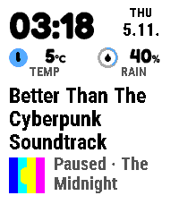

# Dynamic 0.16.2 activity display fixes

Two independent bugs hid paused media. Activities 0.4.3 projected schema-4
paused playback as active, so the watch never received its paused state. Even
when a correct paused frame reached Dynamic, the primary media renderer omitted
the state while the same card in the secondary row showed Paused.

The baseline consumer test fails with `active != paused`. Unmodified 0.16.1
native captures also reproduce identical active/paused primary pixels while the
secondary differs. Evidence remains under `qa/0.16.2/native-before/` with its
original PBW/native hashes; it is not relabelled as a new renderer capture.

Activities 0.4.4 now carries explicit paused playback into the existing native
state field. Playing, buffering, stopped and unknown retain their previous
generic active lifecycle; no completion or new label is inferred. Dynamic
places the localized Paused state first in its existing artwork/artist footer.
The track title, cover, bottom alignment, type sizes and active composition stay
unchanged. Missing or expired artist metadata leaves Paused visible without
showing stale artist text. Existing plan scratch is reused; no timer, schema,
message key, permission or retained content allocation is added.

The consumer regression checks all five playback states in both role orders,
ACT3 state bytes, immutable observation/expiry, app destinations, item token and
the other activity's independent clock anchor. A separate regression protects
standard activities with a media icon from being mistaken for media controls.
Native before/after capture recipes use source revision advances for every
actual change and never bypass the decoder's revision/session checks.

Final native validation passes 22 legacy/typed media captures in both roles,
playback-only updates without incoming-track motion and artist expiry.
Twenty-four fresh native previews bind the embedded settings samples to the
final native payload. 127 JavaScript tests, 13 portable C suites, the actual
callback harness and 50 Python checks pass. Actual minified/serialized EN/CS
Clay pages pass the browser suite, including twelve custom-colour comparisons.
The package audit verifies exact source, ELF, fonts, resources, dependency pins
and optimized JavaScript/maps. Loaded image is 62,160 bytes and static extent
62,576 bytes, leaving 2,959 bytes under the legacy SDK static limit. Executable
and resources match all 46 current native captures; only SDK manifest generation
timestamps differ after the preview-bound final rebuild.

Portable, package, browser and cross-suite evidence lives under `qa/0.16.2/`.
These use synthetic SDK/source data; no new real-phone, physical-watch, battery
or end-to-end delivery claim is made.

The final cross-suite runner passes against the exact packaged Dynamic 0.16.2,
Dashboard 0.3.3, Timer 0.11.2 and unchanged Open Activity 0.1.5. Its four display
cases cover two owner timers through Pause/expiry/Resume/Done, permission
recovery with identical cached responses, an unrelated malformed plugin, and
typed paused media with shortened private availability. It also retains six
privacy/role cases, 48 selected launches, 48 expired closures, 336 unselected
closures and disconnect/provider-withdrawal routing checks. These are synthetic
owner/native/SDK inputs to actual optimized scripts, not remote Timer control
or physical app-launch measurements.

A Dashboard notice-only packaging correction was followed by a fresh run of
the same global checks. The current handoff report names that final Dashboard
PBW; the previous candidate report is retained separately. Dynamic's PBW/debug
bytes and every executed script hash remain unchanged.

The dependency pin is Activities 0.4.4, source
`df4f30f4a66419ce835959eeeec6de7999704fa0`, archive SHA-256
`dffec3e05041515fbf9385a641adf6b40aedda7e8460c0d11ecb4ed019cd5abe`.
Core remains 0.5.1. Published releases and older local candidate bytes stay
unchanged; this is a new local candidate.
